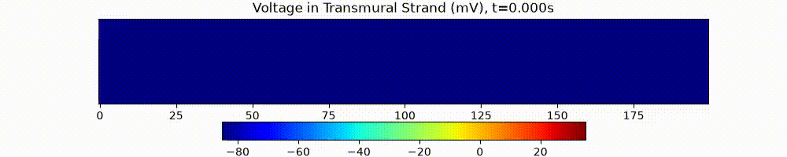
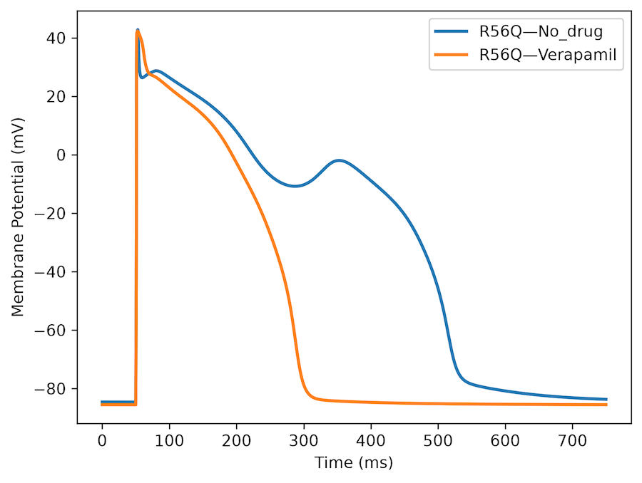
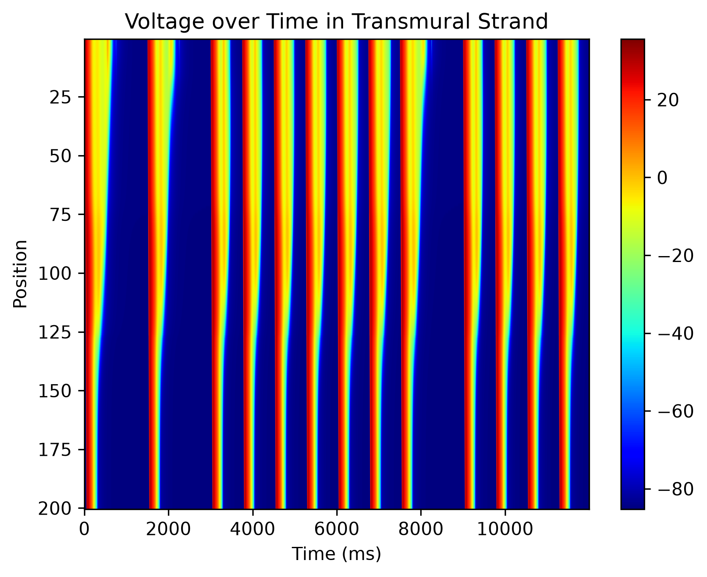
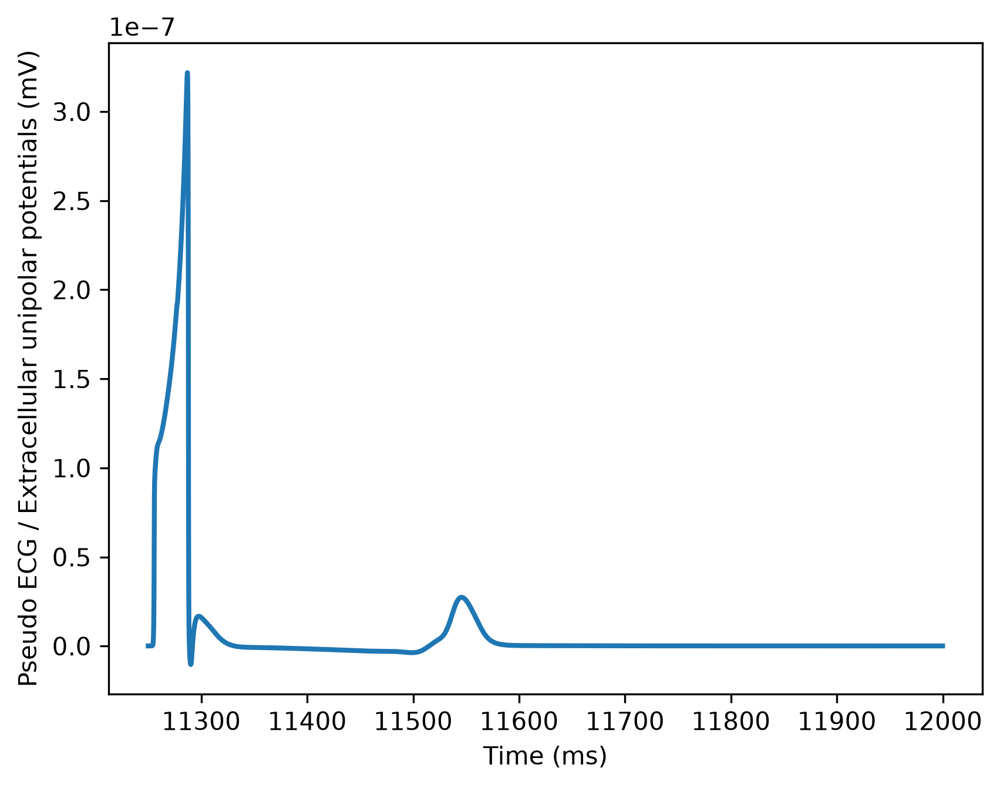

# Long QT Syndrome Type 2 Model

Computational model of human ventricular cardiomyocyte action potentials. Our model captures the LQT2 disease state and response to drug treatments in single cell and 1D transmural simulations. This project was completed as part of the BME 507 course at Duke University.

Authors: Jorik Stoop, Barton Wei, Xixian Jiang

 

### Attribution
This repository extends the model from:

Zhang, S., Lu, W., Yang, F., Li, Z., Wang, S., Jiang, M., Wang, X., Wei, S. (2022). Computational analysis of arrhythmogenesis in KCNH2 T618I mutation-associated short QT syndrome and the pharmacological effects of quinidine and sotalol. npj Syst Biol Appl, 8(43). https://doi.org/10.1038/s41540-022-00254-5

The source code can be found in the GitHub repo [here](https://github.com/ShugangZhang/T618I), and is licensed under the MIT License.  

Changes made in this repository include adjusting the Markov chain model of IKr to induce LQT2 rather than short QT, changing various parameters to enable formation of early after depolarizations (EADs), and creating Python postprocessing scripts for visualization and analysis of simulation outputs. These changes were made by Jorik Stoop, Barton Wei, and Xixian Jiang.

**Other references:**

TP06 model:
* ten Tusscher, K. H., & Panfilov, A. V. (2006). Alternans and spiral breakup in a human ventricular tissue model. American journal of physiology. Heart and circulatory physiology, 291(3), H1088–H1100. https://doi.org/10.1152/ajpheart.00109.2006

Markov model of IKr in wild-type and mutant R56Q/T474I conditions:
*  Clancy, C.E., & Rudy, Y. (2001). Cellular consequences of HERG mutations in the long QT syndrome: precursors to sudden cardiac death. Cardiovascular Research 50(2), 301–313. https://doi.org/10.1016/s0008-6363(00)00293-5

mTP06 to enable EADs based on:
* Kurata, Y., Tsumoto, K., Hayashi, K., Hisatome, I., Kuda, Y. & Tanida, M. (2020). Multiple Dynamical Mechanisms of Phase-2 Early Afterdepolarizations in a Human Ventricular Myocyte Model: Involvement of Spontaneous SR Ca2+Release. Frontiers in Physiology, 10(1545). https://doi.org/10.3389/fphys.2019.01545

 

## Compiling the code

1. Clone the repository with `git clone https://github.com/jorikstoop/LongQT2.git` and enter the `src` directory
2. In the `config.h` file, specify the following:
    - which version of the IKr channel to use = wild-type (WT) or mutated (R56Q/T474I)
    - whether any drug treatment is being applied = isoproterenol (ISO_10nM), spironolactone (K_supplement), or verapamil (Verapamil_300nM)
    - whether to use the modified parameter set that allows for early after depolarization (EAD) in 1D model
    - what the cycle length (BCL) should be
3. Ensure you have a version of g++ installed. Building requires a c++17 compiler with OpenMP support.
4. Run `make clean` and then `make` to compile
5. Return to the root directory

 

## Running the code
1. First run initialization simulations for each cell type (endocardium, myocardium, epicardium) with `./src/model_initialization` to generate a set of stable init parameter values
    * Note: The time step, number of cycles, stimulus strength/duration, and stimulus start time can all be modified in `Initialization.cc`. Just make sure to re-compile after making any changes.
    * `.dat` files will be generated in the `init_vals` directory
2. To run single-cell simulations, use `./src/model_single_cell`
    * `.dat` files will be saved in the `ouput` directory
3. To run simulations in a 1D transmural cable with endo, myo, and epi cell types use `./src/model_oned`
    * `.dat` files will be saved in the `ouput` directory

 

##  Visualization and Analysis

### Single Cell Analysis

For single cell data, the `SingleCellStats_*.dat` output files each contain a list of metrics including the resting membrane potential, maximum upstroke velocity, overshoot, amplitude, and action potential duration.

The `SingleCellResults_*.dat` output files each contain values for individual simulation time steps. To visualize the action potential and IKr channel results:
* update the user options in `postprocess/plot_single_cell_results.py` to select which analyses to run
    - PLOT_AP = create plot of action potential in mV over time
    - PLOT_ION_CURRENTS = create plot of action potential, IKr and ICaL currents over time
    - PLOT_MARKOV_STATES = create plot of state occupancy for Markov IKr
    - PLOT_ALL = create plot with all of the above in a single figure
* run the script with `python3 postprocess/plot_single_cell_results.py output/<SingleCellResults_*.dat>`, or enter the data filepath when prompted

To compare two single-cell simulations against each other:
* update the user options in `postprocess/compare_single_cell.py.py` to select which analyses to run
    - PLOT_AP = create plot of action potentials in mV over time
    - PLOT_IKR = create plot of action potentials and IKr currents over time
    - PLOT_MARKOV_STATES = create plot of state occupancies for Markov IKr
    - PLOT_ALL = create plot with all of the above in a single figure
* run the script with `python3 postprocess/compare_single_cell.py output/<file1.dat> output/<file2.dat>`, or enter the data filepaths when prompted

    

    Example comparison of action potentials in ENDO cells with R56Q mutation and EAD parameters for no drug vs verapamil treatment conditions

 

### Transmural strand analysis

For 1D simulations, the `OneDsodium_*.dat` output files each contain values of Na+ for individual simulation time steps.

The `OneDResults_*.dat` output files each contain voltage values for individual simulation time steps. To visualize action potentials over time:
* update the user options in `postprocess/plot_oneD_results.py` to select which analyses to run
    - PLOT_VOLTAGE_HEATMAP = create heatmap of voltage at each cell in the 1D strand over time
    - PLOT_VOLTAGE_SELECT_CELLS = create figure with subplots showing individual AP at selected cells in strand
        - SELECT_CELLS = list of cell indices specifying which select cells to plot
    - PLOT_PECG = create plot of pseudo ECG with QRS complex and T wave
    - SAVE_VIDEO = create .mp4 file of voltage over time in the 1D strand of cells
* run the script with `python3 postprocess/plot_oneD_results.py output/<OneDResults_*.dat>`, or enter the data filepath when prompted

    

    Example voltage heatmap with EADs generated from 1D simulation of R56Q mutation with no drug.

     

    

    Example pseudo-ECG generated from 1D simulation of wild-type condition.

